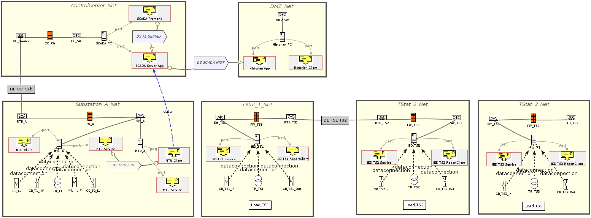

# Telos-Scada-OT-Model
Cyber-physical SCADA/OT system model created using TELOS and the ELVIRA taxonomy.# Cyber-Physical SCADA/OT Model

A cyber-physical system model developed as an individual university
assignment for the course *Cyber Security for Internet of Things and
Critical Infrastructures*.

The model was created using TELOS and the ELVIRA taxonomy and represents
a simplified electrical power distribution system together with its
associated OT and communication infrastructure.

## Overview

The model includes:

- A main substation and three transformer stations
- Power grid components such as transformers, circuit breakers, busbars and power lines
- SCADA, MTU, RTU and IED components
- Routers, switches and firewalls
- Separate networks for substations and transformer stations
- A control centre and DMZ
- A historian system
- Application-level client and server components
- Data connections and unidirectional data streams

## Architecture

The architecture is intentionally simplified for the scope of the assignment and should not be interpreted as a production-ready SCADA/OT reference architecture.

## Tools & Concepts

- TELOS
- ELVIRA taxonomy
- Cyber-physical systems
- SCADA / OT
- Industrial control systems
- Network segmentation
- Static model analysis

## Repository Contents

- `scada_ot_model.txt` – TELOS model
- `images/architecture.png` – visualisation of the modeled architecture
